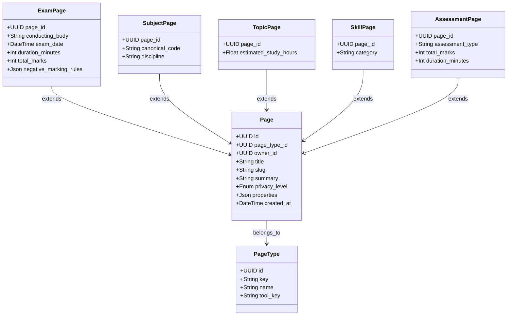

# Implementation Plan - Database & Schema Design

This plan outlines the polymorphic page model and extension table structure for Character Arc, providing a relational database design for PostgreSQL using Prisma and Supabase.

---

## Proposed Schema Architecture

To support a system of modular, AI-operable tools where entities are linkable and have custom metadata, we use a hybrid database design:
1. **Generic `pages` Table**: Handles identity, slug routing, user ownership, privacy policies, tagging, and global search/relations.
2. **Typed Page Extensions**: One-to-one tables corresponding to specific page types (e.g., `exam_pages`, `subject_pages`) holding structured domain fields.
3. **Operational Tables**: Traditional relational tables for high-frequency transactional data like `questions`, `attempts`, `responses`, and `progress_evidences`.



---

## Suggested Improvements & Refinements

1. **Relation Config Table for Polymorphic Edges**:
   An exam's syllabus includes subjects with exam-specific metadata (e.g., expected marks, weightage, order). We introduce `exam_subject_configs` linked directly to the `page_relations` records. This cleanly encapsulates many-to-many relationship metadata.
2. **PostgreSQL Partial Unique Constraints for Slugs**:
   - System-scoped pages (`owner_id IS NULL`) must have globally unique slugs.
   - User-scoped pages (`owner_id IS NOT NULL`) must have slugs unique *per user*.
   - **Solution:** We will define partial indexes in the SQL migration to enforce this:
     ```sql
     CREATE UNIQUE INDEX unique_system_slug ON pages (slug) WHERE owner_id IS NULL;
     CREATE UNIQUE INDEX unique_user_slug ON pages (owner_id, slug) WHERE owner_id IS NOT NULL;
     ```
3. **Evidence-Based Progress Projections**:
   Rather than relying on ad-hoc update calculations, we introduce a read-optimized `topic_progress` table and an immutable `progress_evidences` log. Submitting a test adds evidence, and the database or service client updates `topic_progress` as a projection.

---

## Open Questions

1. **System Catalog vs. User Customization**: Can users modify system-created subjects/topics, or do they only fork them? Currently, the plan allows System pages (`owner_id = NULL`) and user-level overrides via `user_page_state`. Is this sufficient, or do users need to edit system syllabus trees?
2. **Negative Marking Rules**: Different exams (e.g., GATE vs. JEE) have complex rules (e.g., -1/3 for 1-mark MCQs, -2/3 for 2-mark MCQs, no negative marking for NATs). Do we want to structure this JSON in `exam_pages` or keep it free-form?

---

## Proposed Changes

### [NEW] [schema.prisma](file:///c:/Users/sharm/Desktop/Projects/hackathon-openai/prisma/schema.prisma)

```prisma
datasource db {
  provider  = "postgresql"
  url       = env("DATABASE_URL")
  directUrl = env("DIRECT_URL") // Recommended for migrations/Supabase
}

generator client {
  provider = "prisma-client-js"
}

enum PageScope {
  SYSTEM
  USER
}

enum PrivacyLevel {
  LOCAL_ONLY
  SYNCED_PRIVATE
  SHARE_WITH_AI
}

// ----------------------------------------------------
// Core Polymorphic Page Models
// ----------------------------------------------------

model PageType {
  id            String   @id @default(cuid())
  key           String   @unique // e.g., "exam", "subject", "chapter", "topic", "skill", "assessment"
  name          String
  toolKey       String   @map("tool_key") // The tool owning this type (e.g., "exam-prep")
  icon          String?
  schemaVersion String   @default("1.0.0") @map("schema_version")
  isSystem      Boolean  @default(true) @map("is_system")
  createdAt     DateTime @default(now()) @map("created_at")

  pages         Page[]

  @@map("page_types")
}

model Page {
  id           String       @id @default(cuid())
  pageTypeId   String       @map("page_type_id")
  type         PageType     @relation(fields: [pageTypeId], references: [id])
  ownerId      String?      @map("owner_id") // Null for canonical system-catalog pages
  scope        PageScope    @default(USER)
  title        String
  slug         String
  summary      String?
  status       String       @default("DRAFT") // DRAFT, PUBLISHED, ARCHIVED
  privacyLevel PrivacyLevel @default(LOCAL_ONLY) @map("privacy_level")
  icon         String?
  coverFileId  String?      @map("cover_file_id")
  properties   Json?        // flexible schema-less overrides/UI properties
  createdAt    DateTime     @default(now()) @map("created_at")
  updatedAt    DateTime     @updatedAt @map("updated_at")
  archivedAt   DateTime?    @map("archived_at")

  // Type Extensions (1:1)
  examPage       ExamPage?
  subjectPage    SubjectPage?
  topicPage      TopicPage?
  skillPage      SkillPage?
  assessmentPage AssessmentPage?

  // Graph Relations
  relationsFrom  PageRelation[]    @relation("FromPage")
  relationsTo    PageRelation[]    @relation("ToPage")
  
  // Operational Connections
  pageTags       PageTag[]
  userState      UserPageState[]
  evidences      ProgressEvidence[]
  topicProgress  TopicProgress[]
  userSkills     UserSkill[]
  questionTopics QuestionTopic[]
  studyActivities StudyActivity[]

  @@index([ownerId, status])
  @@index([ownerId, createdAt])
  @@map("pages")
}

model PageRelation {
  id          String    @id @default(cuid())
  ownerId     String?   @map("owner_id") // Null for system relationships
  fromPageId  String    @map("from_page_id")
  fromPage    Page      @relation("FromPage", fields: [fromPageId], references: [id], onDelete: Cascade)
  toPageId    String    @map("to_page_id")
  toPage      Page      @relation("ToPage", fields: [toPageId], references: [id], onDelete: Cascade)
  relationKey String    @map("relation_key") // e.g., "includes", "requires", "targets", "related_to"
  position    Int       @default(0)
  properties  Json?     // metadata properties
  createdAt   DateTime  @default(now()) @map("created_at")
  updatedAt   DateTime  @updatedAt @map("updated_at")

  // Extension metadata (for includes relations)
  examSubjectConfig ExamSubjectConfig?

  @@unique([ownerId, fromPageId, toPageId, relationKey])
  @@index([fromPageId, relationKey])
  @@index([toPageId])
  @@map("page_relations")
}

// ----------------------------------------------------
// Page Type Extensions (1:1 with Page)
// ----------------------------------------------------

model ExamPage {
  pageId               String    @id @map("page_id")
  page                 Page      @relation(fields: [pageId], references: [id], onDelete: Cascade)
  conductingBody       String?   @map("conducting_body")
  examDate             DateTime? @map("exam_date")
  durationMinutes      Int?      @map("duration_minutes")
  totalMarks           Int?      @map("total_marks")
  negativeMarkingRules Json?     @map("negative_marking_rules")
  blueprintVersion     String?   @map("blueprint_version")

  @@map("exam_pages")
}

model SubjectPage {
  pageId             String  @id @map("page_id")
  page               Page    @relation(fields: [pageId], references: [id], onDelete: Cascade)
  canonicalCode      String? @map("canonical_code")
  discipline         String?
  defaultDescription String? @map("default_description")

  @@map("subject_pages")
}

model TopicPage {
  pageId              String @id @map("page_id")
  page                Page   @relation(fields: [pageId], references: [id], onDelete: Cascade)
  estimatedStudyHours Float? @map("estimated_study_hours")

  @@map("topic_pages")
}

model SkillPage {
  pageId      String  @id @map("page_id")
  page        Page    @relation(fields: [pageId], references: [id], onDelete: Cascade)
  category    String? // e.g., "Core Academic", "Technical Tool", "Soft Skill"
  description String?

  @@map("skill_pages")
}

model AssessmentPage {
  pageId          String               @id @map("page_id")
  page            Page                 @relation(fields: [pageId], references: [id], onDelete: Cascade)
  assessmentType  String               @map("assessment_type") // QUIZ, MOCK_TEST
  durationMinutes Int?                 @map("duration_minutes")
  totalMarks      Float                @map("total_marks")
  passingMarks    Float?               @map("passing_marks")
  
  questions       AssessmentQuestion[]

  @@map("assessment_pages")
}

// ----------------------------------------------------
// Relation Extensions (e.g. metadata on an edge)
// ----------------------------------------------------

model ExamSubjectConfig {
  relationId      String       @id @map("relation_id")
  relation        PageRelation @relation(fields: [relationId], references: [id], onDelete: Cascade)
  weightage       Float?       // Weightage in percentage or marks
  expectedMarks   Float?       @map("expected_marks")
  section         String?      // e.g., "Core", "General Aptitude"
  syllabusVersion String?      @map("syllabus_version")

  @@map("exam_subject_configs")
}

// ----------------------------------------------------
// User Catalog Context & State
// ----------------------------------------------------

model UserPageState {
  id             String    @id @default(cuid())
  userId         String    @map("user_id")
  pageId         String    @map("page_id")
  page           Page      @relation(fields: [pageId], references: [id], onDelete: Cascade)
  state          String    @default("ACTIVE") // ACTIVE, PAUSED, COMPLETED
  progressPercent Float    @default(0.0) @map("progress_percent")
  confidence     Float     @default(0.0) // self-assessed rating
  priority       String    @default("MEDIUM")
  pinned         Boolean   @default(false)
  lastActivityAt DateTime? @map("last_activity_at")
  properties     Json?

  @@unique([userId, pageId])
  @@map("user_page_states")
}

// ----------------------------------------------------
// Operational Question Bank & Assessment Engine
// ----------------------------------------------------

model Question {
  id                  String   @id @default(cuid())
  ownerId             String?  @map("owner_id") // Nullable for system question bank
  text                String
  solutionExplanation String?  @map("solution_explanation")
  difficulty          String   // EASY, MEDIUM, HARD
  questionType        String   @map("question_type") // MCQ, MSQ, NAT
  marks               Float    @default(1.0)
  negativeMarks       Float    @default(0.0) @map("negative_marks")
  createdAt           DateTime @default(now()) @map("created_at")
  updatedAt           DateTime @updatedAt @map("updated_at")

  // Relations
  options             QuestionOption[]
  questionTopics      QuestionTopic[]
  assessmentQuestions AssessmentQuestion[]
  attemptResponses    AttemptResponse[]

  @@map("questions")
}

model QuestionOption {
  id         String   @id @default(cuid())
  questionId String   @map("question_id")
  question   Question @relation(fields: [questionId], references: [id], onDelete: Cascade)
  text       String
  isCorrect  Boolean  @map("is_correct")
  position   Int      @default(0)

  @@map("question_options")
}

model QuestionTopic {
  id         String   @id @default(cuid())
  questionId String   @map("question_id")
  question   Question @relation(fields: [questionId], references: [id], onDelete: Cascade)
  topicId    String   @map("topic_id")
  topic      Page     @relation(fields: [topicId], references: [id], onDelete: Cascade)

  @@unique([questionId, topicId])
  @@map("question_topics")
}

model AssessmentQuestion {
  id           String         @id @default(cuid())
  assessmentId String         @map("assessment_id")
  assessment   AssessmentPage @relation(fields: [assessmentId], references: [pageId], onDelete: Cascade)
  questionId   String         @map("question_id")
  question     Question       @relation(fields: [questionId], references: [id], onDelete: Cascade)
  position     Int            @default(0)

  @@unique([assessmentId, questionId])
  @@map("assessment_questions")
}

// ----------------------------------------------------
// Operational Performance & Progress Evidence
// ----------------------------------------------------

model Attempt {
  id           String            @id @default(cuid())
  userId       String            @map("user_id")
  assessmentId String            @map("assessment_id") // References Page.id
  status       String            @default("IN_PROGRESS") // IN_PROGRESS, COMPLETED, ABANDONED
  score        Float             @default(0.0)
  accuracy     Float             @default(0.0)
  timeSpentSec Int               @default(0) @map("time_spent_sec")
  startedAt    DateTime          @default(now()) @map("started_at")
  completedAt  DateTime?         @map("completed_at")

  responses    AttemptResponse[]
  evidences    ProgressEvidence[]

  @@index([userId, status])
  @@map("attempts")
}

model AttemptResponse {
  id                String   @id @default(cuid())
  attemptId         String   @map("attempt_id")
  attempt           Attempt  @relation(fields: [attemptId], references: [id], onDelete: Cascade)
  questionId        String   @map("question_id")
  question          Question @relation(fields: [questionId], references: [id], onDelete: Cascade)
  selectedOptionIds String[] @map("selected_option_ids") // Option CUIDs chosen
  textAnswer        String?  @map("text_answer")          // NAT decimal or MSQ strings
  isCorrect         Boolean  @default(false) @map("is_correct")
  scoreObtained     Float    @default(0.0) @map("score_obtained")
  timeSpentSec      Int      @default(0) @map("time_spent_sec")
  isFlagged         Boolean  @default(false) @map("is_flagged")
  errorType         String?  @map("error_type")           // CONCEPTUAL, CALCULATION, SILLY_MISTAKE, TIME_OUT

  @@unique([attemptId, questionId])
  @@map("attempt_responses")
}

model ProgressEvidence {
  id           String   @id @default(cuid())
  userId       String   @map("user_id")
  pageId       String   @map("page_id") // References Page.id (usually Topic or Skill)
  page         Page     @relation(fields: [pageId], references: [id], onDelete: Cascade)
  sourceType   String   @map("source_type") // "ATTEMPT", "REVISION", "MANUAL"
  sourceId     String?  @map("source_id")   // generic source ID
  attemptId    String?  @map("attempt_id")
  attempt      Attempt? @relation(fields: [attemptId], references: [id], onDelete: SetNull)
  evidenceKey  String   @map("evidence_key") // e.g. "QUESTION_CORRECT", "TOPIC_STUDIED"
  numericValue Float    @map("numeric_value") // value weight (e.g. 1.0 or accuracy score)
  properties   Json?
  recordedAt   DateTime @default(now()) @map("recorded_at")

  @@index([userId, pageId])
  @@index([userId, recordedAt])
  @@map("progress_evidences")
}

model TopicProgress {
  id            String    @id @default(cuid())
  userId        String    @map("user_id")
  topicId       String    @map("topic_id")
  topic         Page      @relation(fields: [topicId], references: [id], onDelete: Cascade)
  mastery       Float     @default(0.0) // 0.0 to 1.0
  confidence    Float     @default(0.0) // 0.0 to 1.0
  revisionCount Int       @default(0) @map("revision_count")
  practiceCount Int       @default(0) @map("practice_count")
  lastStudiedAt DateTime? @map("last_studied_at")
  updatedAt     DateTime  @updatedAt @map("updated_at")

  @@unique([userId, topicId])
  @@map("topic_progress")
}

model UserSkill {
  id            String    @id @default(cuid())
  userId        String    @map("user_id")
  skillId       String    @map("skill_id")
  skill         Page      @relation(fields: [skillId], references: [id], onDelete: Cascade)
  rating        Float     @default(0.0) // 0 to 10
  evidenceCount Int       @default(0) @map("evidence_count")
  lastActiveAt  DateTime? @map("last_active_at")
  updatedAt     DateTime  @updatedAt @map("updated_at")

  @@unique([userId, skillId])
  @@map("user_skills")
}

model StudyActivity {
  id              String   @id @default(cuid())
  userId          String   @map("user_id")
  pageId          String   @map("page_id")
  page            Page     @relation(fields: [pageId], references: [id], onDelete: Cascade)
  activityType    String   @map("activity_type") // e.g., "READ", "REVISE", "PRACTICE"
  durationMinutes Int      @map("duration_minutes")
  notes           String?
  recordedAt      DateTime @default(now()) @map("recorded_at")

  @@index([userId, pageId])
  @@index([userId, recordedAt])
  @@map("study_activities")
}

// ----------------------------------------------------
// System Integration & Permissions
// ----------------------------------------------------

model ToolInstallation {
  id            String   @id @default(cuid())
  userId        String   @map("user_id")
  toolKey       String   @map("tool_key")
  isEnabled     Boolean  @default(true) @map("is_enabled")
  configuration Json?
  installedAt   DateTime @default(now()) @map("installed_at")
  updatedAt     DateTime @updatedAt @map("updated_at")

  @@unique([userId, toolKey])
  @@map("tool_installations")
}

model ToolPermission {
  id           String   @id @default(cuid())
  userId       String   @map("user_id")
  toolKey      String   @map("tool_key")
  resourceType String   @map("resource_type") // "PAGE_TYPE", "CONNECTOR"
  resourceId   String?  @map("resource_id")
  canRead      Boolean  @default(false) @map("can_read")
  canWrite     Boolean  @default(false) @map("can_write")
  createdAt    DateTime @default(now()) @map("created_at")

  @@map("tool_permissions")
}

model Tag {
  id        String    @id @default(cuid())
  name      String    @unique
  color     String?
  createdAt DateTime  @default(now()) @map("created_at")
  pageTags  PageTag[]

  @@map("tags")
}

model PageTag {
  id        String   @id @default(cuid())
  pageId    String   @map("page_id")
  page      Page     @relation(fields: [pageId], references: [id], onDelete: Cascade)
  tagId     String   @map("tag_id")
  tag       Tag      @relation(fields: [tagId], references: [id], onDelete: Cascade)
  createdAt DateTime @default(now()) @map("created_at")

  @@unique([pageId, tagId])
  @@map("page_tags")
}
```
# Superseded Implementation Draft

> This page-model proposal predates the implemented workspace and block schema. Use [GENERIC_BLOCK_MODEL.md](./GENERIC_BLOCK_MODEL.md), `prisma/schema.prisma`, and the current Supabase migration as the source of truth.
